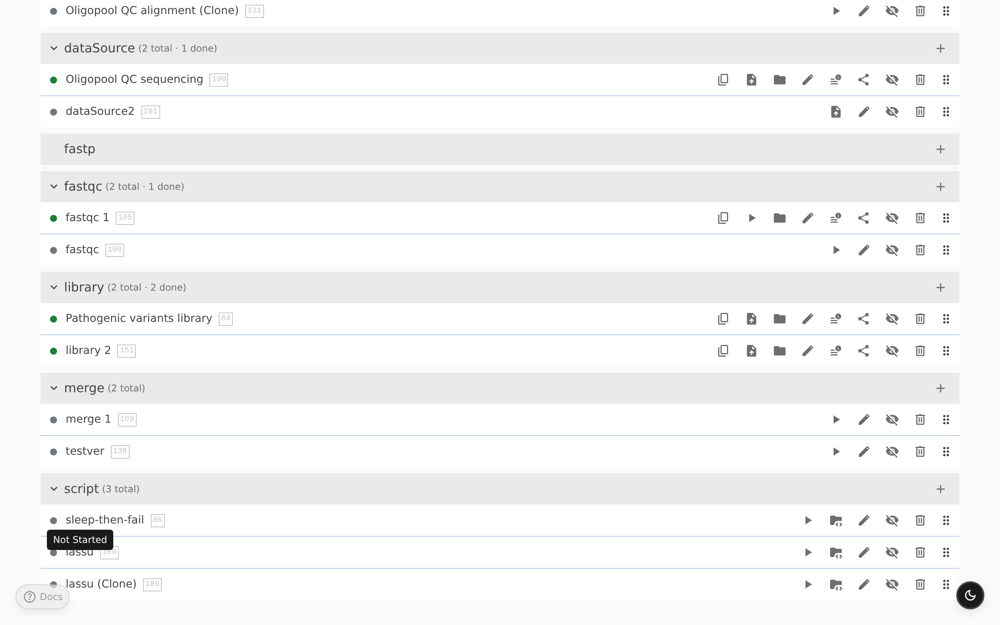

# Runs

Run a step and Pointy keeps the result together with the inputs, software, and parameters that produced it. You can inspect the files, compare them with another run, or send a colleague a link to what you are looking at.

## Running a step

Click **Run** on the step you want to use. If it needs results from other steps, Pointy runs those first. It reuses results that are already available for the same inputs and settings.

Run is offered on steps that are **Not Started**, **Failure**, **Not Certified**, or **Certification Failed**; it disappears while a step is running or successful. If the step's form is open, **Run** saves it first and builds the saved version.

## Step statuses

The dot beside a step shows its progress:

-  **Not Started**: there is no result available yet.
-  **Running**: the step is queued or running. Uploading and indexing also show this dot.
-  **Success**: the program finished and its output files are available.
-  **Failure**: the run failed. Hover over the dot for an error summary, or click it to read the log.
-  **Not Certified**: the step's output was built, but Pointy has not confirmed that it matches the output type its template declares.
-  **Certification Failed**: the step's output was built, but the check against the declared output type failed. Click the dot to read the log.
-  **Loading**: Pointy is checking the status, or waiting for a run to start.

The display updates automatically; you do not need to keep refreshing the page.

### Keeping track of work

The bottom status bar shows the state of the computing service and how many steps are active. It reads **Connecting** while the status loads, **Cluster OK** when the service is available, and **Degraded**, **Unavailable**, or **Cluster unknown** when there is a problem; a short reason follows the label when one is known, and hovering shows the full sentence.

Beside it, the summary counts steps by state: running, queued, starting, and uploading. Click the summary to open the activity panel. Steps are grouped under **Running**, **Queued**, **Starting**, and **Uploading**, and you can collapse a group. When the scheduler gives a reason, a queued step shows why it is waiting — for upstream steps, free CPUs or memory, higher-priority jobs, a scheduled start, a hold, unavailable nodes, or the raw Slurm reason — along with how long it has waited; hover the step for the full sentence. Running and starting steps show elapsed time when there is one, and uploads show their progress. Choose any step to open it. Rows for running, queued, and starting steps have **Stop**; upload rows do not.

The summary covers the whole instance, so a step you upload or start on this page appears in it. **Idle** appears only once status has loaded and no step is running, queued, starting, or uploading; the health label, not **Idle**, tells you whether the service is available.

The bar also identifies the version you are viewing: the branch, with the commit on hover. From an older version it shows **Past · View current**, which returns you to the current version. **Agent**, **Docs**, the light/dark control, and the **Notifications** bell are here too, along with the account menu when you are signed in.

When a run started from this page finishes, a toast names the step, for example **Step 'Read QC' completed**. Failed runs do not raise a toast; their dot turns red. For a failed step, open its log and choose **Investigate with agent**. The log is included in the chat, so you can ask what went wrong without copying the error. The log text can be selected and copied; long logs scroll in the popover. See [Agent](agent.md).

Recent messages are kept under the **Notifications** bell: each entry shows the first line and how long ago it arrived, and expands to the full text. **Dismiss all** on the top toast clears the stack, but leaves the notification history in place.

## Stopping a running step

While a step is running, **Stop** appears in place of **Run**; you can also stop a queued or starting build from its row in the activity panel. Use it to cancel the run before changing the step and trying again. Pointy replaces the button with a disabled **Stopping** button until the step stops, and the cancelled run ends as **Failure**. Stop cancels only this step's own run: input steps that had already started keep running.

## Uploading files

File-upload steps have **Upload files** instead of **Run**. The file picker shows the formats accepted by that template.

You can submit one or more files at a time, follow the transfer progress, and cancel an upload in progress. A single submission accepts at most 100 files; larger sets should be packaged as a zip archive or divided among several file-upload steps.

After the transfer, Pointy indexes the uploaded files and shows the progress on the step row. When indexing finishes, the page runs the step; keep the page open until the run starts. Each upload **replaces** the step's data rather than adding to it, so upload everything a step needs in one go.

If your installation has a scratch space, file-upload steps also have **From scratch**. It opens a browser for the server-side scratch directory. Open the folder that holds your data and choose **Wrap this directory**. The whole folder becomes the step's input without passing through your browser; the scratch root itself cannot be wrapped. Indexing takes some time, but nothing is copied or moved.

