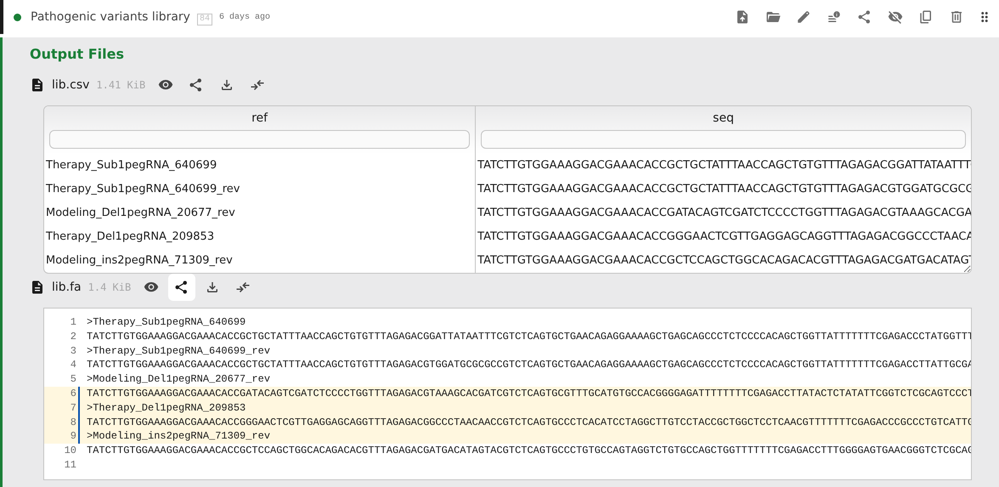

# Pointy Notebook

Welcome to the Pointy Notebook home page.

Pointy helps research teams keep computational work tidy by storing inputs, software, notes, and results together so any run can be inspected in its wholeness. It achieves a very high level of computational reproducibility by utilizing the Nix sandbox, an isolated computational environment where the only way to enter data and software is by precise advance declaration. If you do the in vitro part of an experiment in a sterile environment, you should do the same with the in silico part, shouldn't you? Moreover: with Pointy, all workflows are ordinary code. You plug in a Git repository and Pointy writes versioned workflow definitions in it. Conveniently, you can edit the same repository using your own tooling: VS Code, LLM agents, etc. It's really that simple. And tidy. Marketing called and they told me to keep using the word "tidy".

The sections below describe three ways to work with Pointy: through the web UI, with an LLM working directly in the repository, or through a custom UI built against the backend API.

## Browse, share, and run simple analyses through the web UI

Pointy's web UI supports established analyses from setting up a folder through sharing results. Folders hold analysis steps (programs with their parameters, each made from a predefined analysis called a template), uploaded files, run states, and outputs. Folders nest inside other folders under Home, and the same step can appear in several folders. Results can be viewed in the browser as text, HTML, images, molecular structures, CSV, or TSV, compared with other outputs, reviewed, and shared using a read-only link to the exact state of the repository.

The built-in AI agent can set up or change an analysis when you ask it to. Its edits stay separate until you inspect and apply them.

→ [Managing Folders](projects.md) · [Working with Steps](steps.md) · [Running Steps and Viewing Results](execution.md) · [AI Agent](agent.md)

## Use your own LLM workflow

The Pointy data store is a Git repository, and step definitions are represented as plain Nix attribute sets, which are directly analogous to JSON objects. An LLM can work on the analysis directly: creating steps, connecting inputs and dependencies, adding scripts, and changing how results are combined.

For example, a bioinformatician processing a 96-well plate can define the per-sample analysis once, use an LLM to create and configure the steps for all 96 samples, and add an aggregate step that produces plate-level statistics and charts. This avoids creating and connecting dozens of runs by hand. The resulting workflow remains inspectable, versioned code in the repository rather than state held inside an LLM session.

→ [Setting Up the User Repository](user-repo-setup.md) · [CLI Reference](cli-reference.md)

## Build your own UI against the backend API

Some analyses require a dedicated workflow wizard that validates an experimental design, collects task-specific parameters, presents conditional questions, or generates a large set of connected analysis steps.

Pointy provides the platform behind such a UI. Templates defined in the user repository describe the available step types and their inputs. The backend API exposes the creation and configuration of those steps, runs them, reports their status, and exposes their outputs. Pointy catalogs every run and keeps its outputs connected to the inputs, parameters, and upstream steps that produced them, so the custom UI can focus on the task-specific workflow instead of run storage, output management, and data lineage.

→ [Using the Backend API](api-guide.md) · [Backend API Reference](api/) · [Type Reference](type-reference.md)

## Sharing results

A Pointy link can open a folder read-only at a specific Git commit, deep-link to an output file or directory, and highlight selected lines in a text result. The recipient sees the state that was shared, not whatever happens to be current later.

[Read the sharing documentation →](execution.md#share-links-and-read-only-views)

## Deployment and storage

The frontend and backend are self-hosted. A NixOS module is provided for easy setup; check out Pointy's source code. Workflow state lives in the Git-backed user repository, and Nix defines and evaluates builds. Every run is submitted as a Slurm job; the supplied `single-node-slurm` NixOS module sets up a single-node Slurm cluster. The outputs of successful runs are kept reachable through registered garbage-collector roots.

→ [Instance Admin Guide](admin.md)

## Documentation

### Using Pointy Web

- [Managing Folders](projects.md): organize an analysis in folders: create, nest, move, link, hide, and delete folders and steps, and jump to any step.
- [Working with Steps](steps.md): create steps from templates, set their inputs and parameters, and edit or clone them.
- [Running Steps and Viewing Results](execution.md): run and stop steps, upload files, inspect and compare outputs, work with source files, review results, and create share links.
- [AI Agent](agent.md): ask the built-in agent to set up or change an analysis, then inspect and apply its changes.

### Defining and hosting workflows

- [Instance Admin Guide](admin.md): runtime architecture, backend configuration, Slurm, uploads, status streaming, the agent runner, and GC roots.
- [Setting Up the User Repository](user-repo-setup.md): create the Git-backed flake that defines templates, steps, folders, and source files.
- [Type Reference](type-reference.md): settings for template inputs and the form widgets they produce.
- [CLI Reference](cli-reference.md): inspect and build flake outputs directly with `nix`.

### Using the backend API

- [Using the Backend API](api-guide.md): read a consistent revision, change folders and steps, follow runs, and work with files from your own client.
- [Backend API Reference](api/): explore endpoints or build a client from the generated OpenAPI reference.

Pointy is distributed under the GNU AGPL v3.
