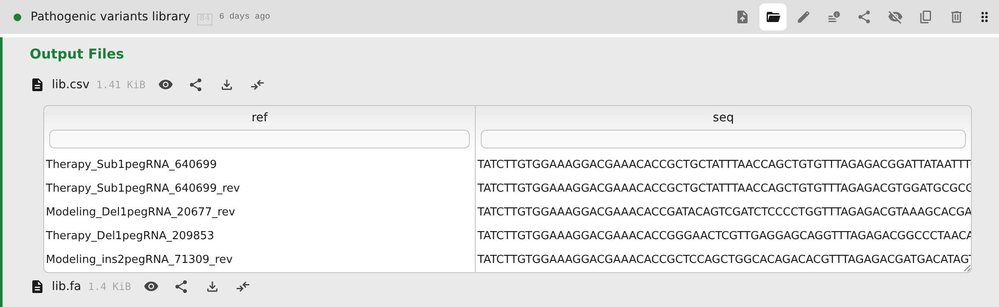
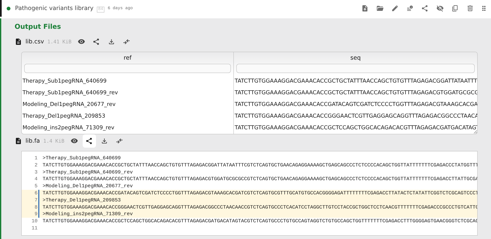
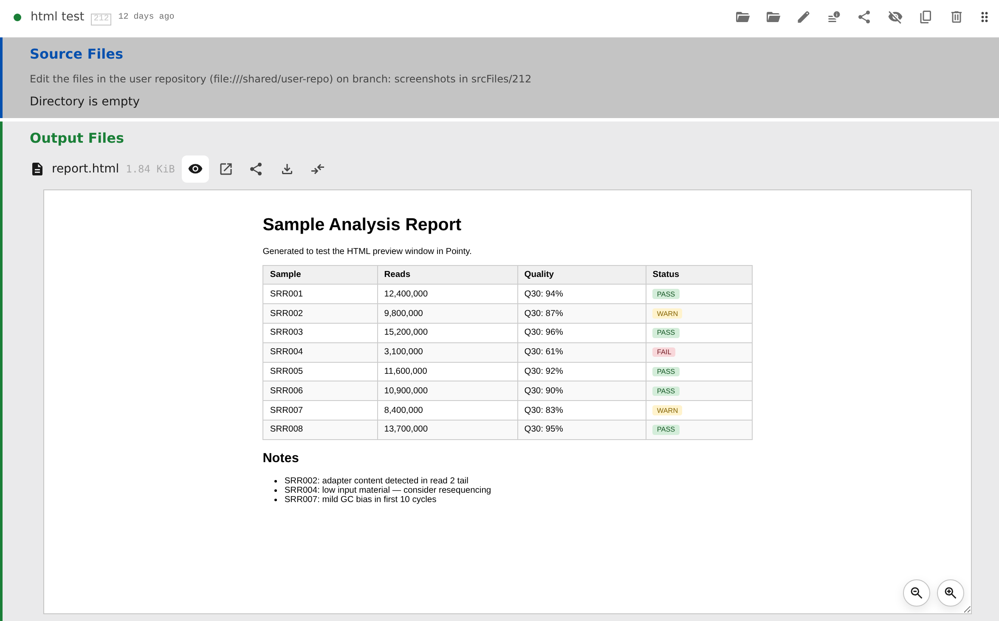
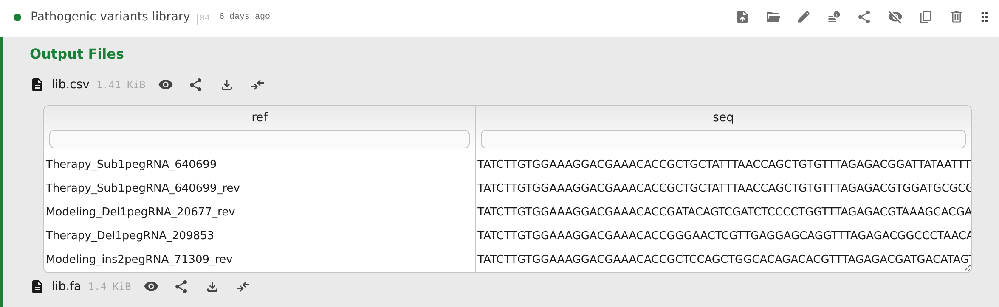
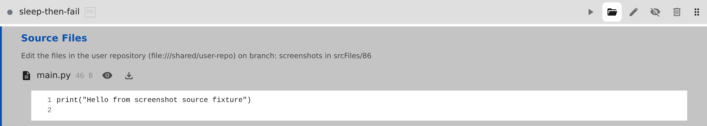
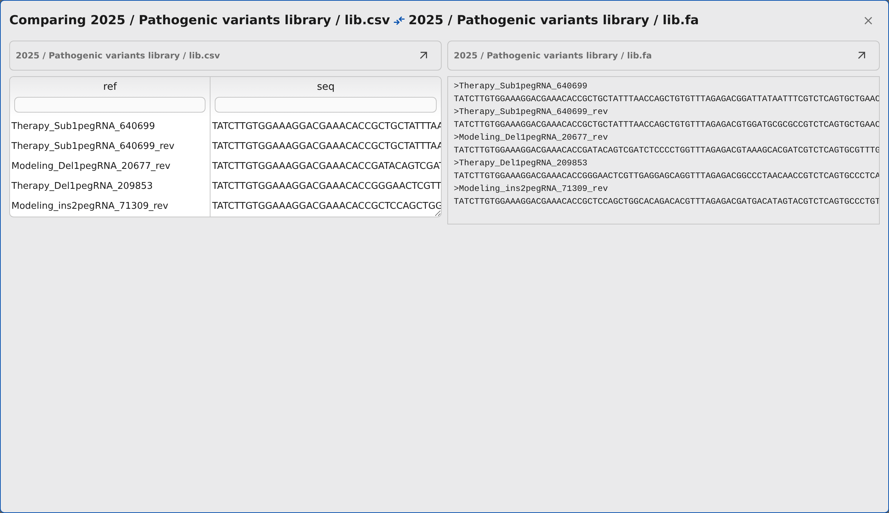

# Outputs

## Browsing output files

Use the **Browse output files** button on a step with a result, or click anywhere on its row header. Expand folders, preview files, or download them. You can share a link to all the results, one folder or file, or selected lines of text.

For text files, click a line number to select one line, or drag over the line numbers to select a range. The address bar updates as you select, and the file's **Share** button becomes **Share lines a-b**. The link opens the same version of the file with those lines highlighted.

Large text files are loaded a section at a time as you scroll, rather than all at once.

Download retrieves the complete file regardless of size.

An open preview stays open when a new version leaves that step's build unchanged; it keeps showing the version you opened. If the build changes, the preview closes so an old result is not mistaken for the new one.

If your installation keeps older outputs on cold storage, the file row shows a snowflake and explains that the file is fetched when opened. Opening or downloading a cold file fetches it first and shows progress on the row; the preview or download starts when the fetch is complete. A failed fetch shows a failure message.

HTML reports open inline; their magnifier buttons zoom in and out. Links in a report work as they would outside Pointy: clicking one can navigate the whole tab, and popups open in a new tab. Use the browser's Back button to return.

Files with a browser-friendly type — HTML, plain text, CSS, XML, JSON, JavaScript, CSV and TSV, images, audio, and video — also have **View external**, which opens the file in a full-window view in a new tab. The view includes a **View in Pointy** link back to the step, and **Open agent** and **Ask agent** for [asking the agent about the file](agent.md#asking-about-part-of-an-artifact); CSV and TSV keep the grid viewer and its **Download** button. Other output files do not offer this view.

When the step's output at the branch head differs from the one shown, the view says so, and once that output is built, **View newer revision** opens it. The chat in this view works with the step's current revision, so **Run** in a step mention builds the head, not the shown commit; when that build produces output, the view switches to it.

Images open inline, and PDB output files have an interactive molecular viewer. Zip archives can be expanded like folders, so you can inspect their contents without downloading and unpacking the whole archive. The archive's download button still retrieves the zip file itself.

## CSV and TSV grid preview

CSV and TSV output files open as a table you can sort and filter.

Use **Grid viewer** for the table or **Regular viewer** for the original text with line numbers. Links to selected lines open in the regular viewer.

Each column has:

- a header you can click to cycle ascending → descending → unsorted
- a filter input below the header
- a draggable right-edge handle for resizing

How a filter is read depends on the column:

- numeric columns accept comparisons such as `>10`, `>=10`, `<5`, `<=5`, `=7`, or `!=0`, a range such as `10-100`, or a bare number, which means equality. A value that is not a number does not match.
- text columns accept a substring, `=exact`, `!=exact`, and `<`, `<=`, `>`, or `>=`. Comparisons ignore case and use numeric order when both values are numbers; otherwise they compare as text.
- an empty filter shows all rows.

An invalid filter is marked and ignored. The toolbar shows how many rows match, such as `1234 rows (filtered from 5000 rows)`, and offers **Clear filters** when any filter is set. **Summary rows** adds Mean, Median, Min, Max, or Sum rows for numeric columns, and Count or Distinct for any column. Summaries cover only the rows that pass your filters; remove one with its close button.

Some templates provide the types of their columns. Without that information, Pointy treats every column as text, so values sort as text and “10” can appear before “2”. Pointy may still be preparing this information the first time you open a folder; try again once that work has finished. If sorting remains unsuitable, ask your administrator about the template.

## Source files

A step may have **Source Files**, such as a script, a configuration file, or a small sample table. These are files the step uses, not results it produces. The agent can edit them, and you can inspect or edit them yourself. The Source Files section is part of the step's **Edit** form, so the step must exist before you can add files to it.

To edit them in Pointy, open the step's **Edit** form:

1. Open a text file with its **Edit …** button, labelled with the file name, and change its contents, or choose **New file**, enter a name and contents, and click **Create**.
2. Use **Delete** to remove a file or **Restore** to cancel its planned deletion. Check the **New**, **Changed**, and **Deleted** badges before saving.
3. Click the step form's **Save** to keep the changes. **Cancel** discards the unsaved changes.

**Create** and **Delete** do not save immediately; you still need to click **Save** on the step. If saving fails, some files may already have been saved. Reopen the step and check them before trying again.

Source files on a reviewed step or in a read-only view cannot be edited. You can still browse and download them, and share a selected line range. Remove the review, make a copy of the step, or return to the current version if you need to make changes.

## Comparing files

Click **Compare** on the first file, then choose a second file you can preview. It can come from the same step or another step, and can be an output or source file. Use **Cancel** in the comparison banner if you picked the wrong first file.

After you pick the second file, Pointy opens them side by side. Copy the browser address to reopen or share that comparison. For output files, the link keeps the versions you selected.

The comparison dialog adapts to the file type:

- text files are shown side by side; when both load in full, differing lines are highlighted. Large files load a window at a time as you scroll each pane
- CSV and TSV files use the same sortable, filterable grid preview as the normal file browser, including summary rows
- images are shown side by side
- HTML reports open in separate preview panels

For analysis outputs, you can also inspect the step parameters that produced each file. **Open source in project** takes you back to that file in its folder.

