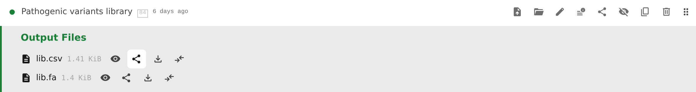

# Sharing

## Share links and read-only views

Use **Share** on a step that has a result or is running, an output file or output folder, or a selection of source-file lines. Failed steps do not offer the step-level share action.

A share link:

- opens the folder in a **read-only** view
- keeps the version you were viewing, rather than following future edits
- can open a particular step, file, folder, or selected lines of text

Your colleague sees the same saved inputs, parameters, and files, with any selected lines highlighted. If the shared file's step has not been built at that version yet, the file opens as soon as the build completes. They need access to the same Pointy instance; sharing a link does not make the folder public.

The read-only view still allows **Run** and **Stop**, **Share**, and the review controls. Editing, uploading, and organizing are disabled.

Use **Past · View current** in the status bar to return to the current version.

## Read-only views

A [share link](#share-links-and-read-only-views) can open a folder at a fixed commit; its URL carries `?commit=`. In such a view you can still browse folders, sort and group the listing, show hidden items, search for steps, read the rollups, and copy share links for built steps and their files. Everything that would change the repository is gone: no checkboxes or action bar, no **New** menu, **Link existing**, **Unhide all**, or clipboard controls, no dragging, no **Edit project**, and no inline rename. Step rows offer **Inspect Parameters** instead of **Edit**; folder rows offer neither. An older version's status bar offers **View current** to return to the latest state.
