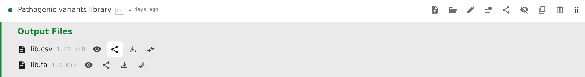

# Sharing

## Share links

Use **Share** on a step that has a result or is running, an output file or output directory, or a selection of source-file lines. Failed steps do not offer the step-level share action.

A share link:

- opens the folder in a [read-only view](#read-only-views)
- keeps the version you were viewing, rather than following future edits
- can open a particular step, file, directory, or selected lines of text

Your colleague sees the same saved inputs, parameters, and files, with any selected lines highlighted. If the shared file's step has not been built at that version yet, the file opens as soon as the build completes. They need access to the same Pointy instance; sharing a link does not make the folder public.

## Read-only views

A [share link](#share-links) opens a folder at a fixed commit; its URL carries `?commit=`. In such a view you can still browse folders, sort and group the listing, show hidden items, search for steps, read the rollups, and copy share links for built steps and their files. **Run**, **Stop**, and the review controls keep working.

Editing, uploading, and organizing are disabled: there are no checkboxes or action bar, no **New** menu, **Link existing**, **Unhide all**, or clipboard controls, no dragging, no **Edit project**, and no inline rename. Step rows offer **Inspect Parameters** instead of **Edit**; folder rows offer neither.

Use **Past · View current** in the status bar to return to the current version.
