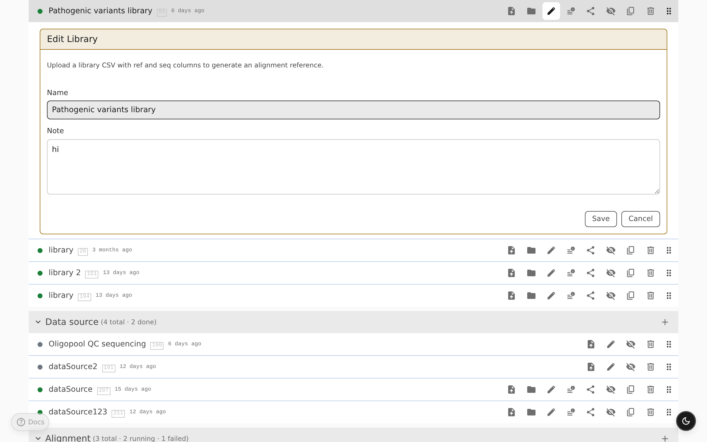
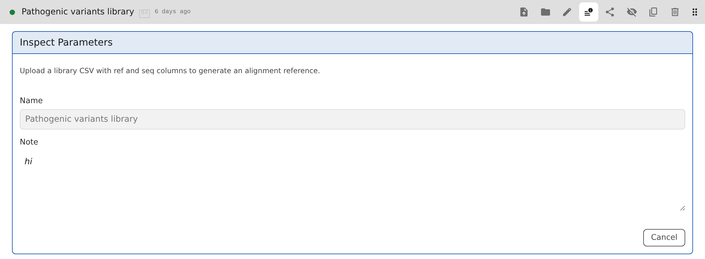

# Steps

An analysis is usually more than one command. You bring in data, run a program, inspect the result, and pass it to the next program. Pointy calls each of these pieces a step. Folders group related steps so you can follow the analysis from inputs to results; the top-level folder is Home.

The [Agent](agent.md) can create and connect steps for you. Try asking it to explain an existing step, make a copy with different parameters, or set up the same analysis for several samples. You inspect its proposed changes before applying them. The controls below let you check the resulting steps and make changes yourself.

Every step comes from a template. A template supplies the program and the parameter form. The **New** menu lists a **New …** item for each template of the current folder and keeps every other template under **Other types**, so any template can be added from any folder. See [Folder templates](projects.md#folder-templates).

## Step types

Pointy has three kinds of step.

### File upload steps

Use a file-upload step to bring in data from your computer, such as a sample table or sequencing reads. Choose **Upload files** and select the files. The file picker shows the formats accepted by that template.

Once the data is uploaded, you can select this step as an input to another step in the same folder.

### Analysis steps

An analysis step runs a program on your chosen inputs. Its form may ask you to select input steps, enter parameters, choose options, or edit a script. Some forms let you add several inputs or a row of settings for each sample.

Selecting another step as an input connects the two: the analysis uses that step's output files. Pointy runs any required input steps first.

### Download steps

A download step brings in a file from a web address. Enter an HTTP or HTTPS address and save the step. Pointy downloads the file and records which version it received, so later runs use the same content rather than silently accepting a changed file.

The form shows **Downloaded at**. Editing the step without changing the address does not download the file again. Changing the address fetches a new file.

Use **Run**, **Stop**, and the output browser as you would for an analysis step.

## Creating steps

Use the **New** menu in the listing header. It offers **New folder**, one **New …** item per template of the folder, and **Other types** with every other template. Choosing a step item opens its form above the listing: give the step a **Name**, fill in the fields, and choose **Save**. If the template list cannot be loaded, the folder shows **Step config failed to load**, the error, and a **Go home** link instead of waiting indefinitely.

Steps that can fill another step's input offer **Create …** shortcuts on their row. For example, a sample-table step may offer **Create Read QC** with the uploaded data already selected. A shortcut appears when the folder already holds a step of the target template and this step's output can fill one of its inputs. Choosing it opens the target's form with that input filled in.

To use a step that already exists instead of creating one, choose **Link existing** in the listing header. The same step then appears in both folders, and editing it in one place changes it in both. See [Moving, linking, and reordering](organize.md#moving-linking-and-reordering).

## Choosing inputs and parameters

When you create or edit a step, its form asks for the settings that program needs. For example, you might choose a set of reads, select single-end or paired-end data, and set a threshold.

Fill in the fields, choose from the dropdowns, and add list entries or sample rows as needed. Some fields suggest values as you type; you can still enter your own value.

Step pickers list matching steps that are already in the current folder; steps from other folders are not offered. To use one of those, link it into this folder first (see [Moving, linking, and reordering](organize.md#moving-linking-and-reordering)). Pointy lists only steps whose output type fits the field, and never the step you are editing. The menu shows each candidate as its id, type, and name; a selected input shows its name, and hovering it shows its id and type. A saved input that no longer exists is listed as missing until you replace it.

Read any notes beside the fields: they may explain an option or point out something to check. These notes come from the template and are guidance, not a check that your analysis is correct.

## Editing, inspecting, and duplicating

A step row offers **Edit** when you can change it, or **Inspect Parameters** when you can only look. Both open the same form; the read-only form ends with **Close** instead of **Save** and **Cancel**.

A reviewed step is locked: the row's edit button is disabled and its tooltip says **Remove review to edit**. Open the form read-only, or use **Duplicate** to try a variation without changing the reviewed result. A shared link to an older version is read-only as well; return to the current version with **Past · View current** in the status bar.

Saving a change does not alter what an existing share link shows. The row's **last modified** time tells you when the step was last changed; hover over it for the exact date and time.

To change just the name, click the pencil beside it. Press Enter or click outside the field to save; Escape cancels.

Use **Duplicate** when you want to try different parameters without changing the original step. It creates a separate, editable step with the same settings. The action is available on any step in an editable folder, including a reviewed step, and appends `(Clone)`, then `(Clone 2)`, and so on to the copy's name. **Duplicate** also appears in the actions for a selection of rows.

Duplicating also copies the step's **Source Files**, if it has any. You can edit the copied scripts and files without changing the original; source files are edited in the step's form (see [Source files](outputs.md#source-files)).

### Change highlighting while editing

A yellow border marks a field you have changed but not yet saved. Check these highlights before choosing **Save**, or use **Cancel** to leave the step unchanged. Closing the form without saving discards your edits.

### Notes on steps

Use **Note** to explain a decision, record a caveat, or leave a link for a colleague. The note stays with the step wherever it appears.

## Working with folders

A step can sit in several folders at once. Removing, hiding, moving, and reordering steps are folder operations: see [Removing and deleting](organize.md#removing-and-deleting), [Hidden items](organize.md#hidden-items), and [Moving, linking, and reordering](organize.md#moving-linking-and-reordering). To jump to a step anywhere in the instance, use [Searching for a step](search.md#searching-for-a-step).

For running steps, uploading files, inspecting outputs, and sharing results, continue with [Runs](execution.md), [Outputs](outputs.md), and [Sharing](sharing.md).
